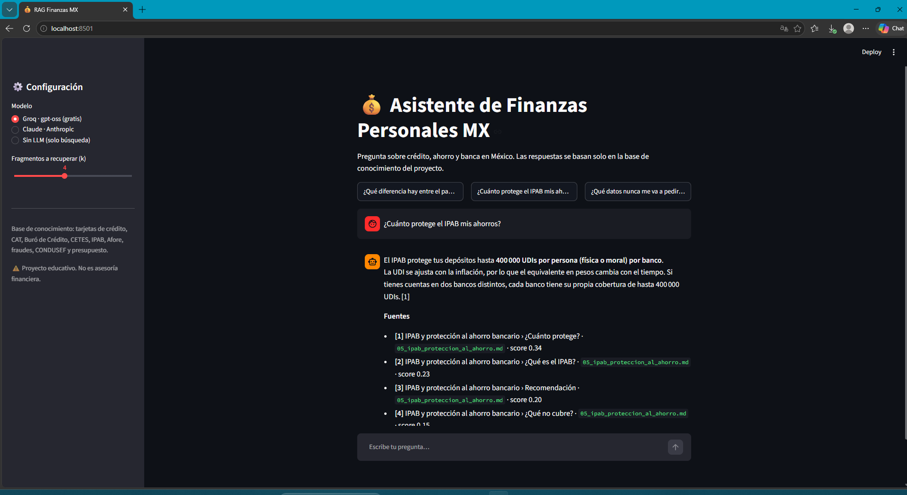
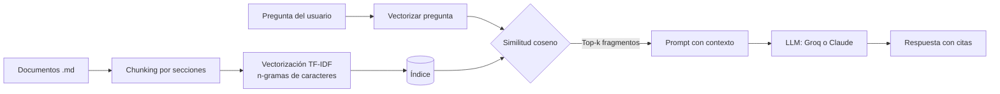

# 💰 RAG de Finanzas Personales MX

Asistente de preguntas y respuestas sobre **finanzas personales y banca en México** construido con la técnica **RAG (Retrieval-Augmented Generation)**. El sistema busca primero en una base de conocimiento propia y después le pasa los fragmentos encontrados a un modelo de lenguaje para que redacte una respuesta **citando sus fuentes**.



Funciona con dos proveedores de LLM intercambiables:

| Proveedor | Modelo por defecto | Costo |
|---|---|---|
| **Groq** | `openai/gpt-oss-20b` | Plan gratuito |
| **Claude (Anthropic)** | `claude-haiku-5-5` | De pago por uso |
| **Sin LLM** | — | Gratis, solo muestra los fragmentos encontrados |

> ⚠️ Proyecto educativo de portafolio. La información es general y no constituye asesoría financiera.

---

## 🧠 ¿Cómo funciona?



1. **Ingesta** (`ingest.py`): lee los documentos de `data/docs/`, los divide en fragmentos por sección (`##`) y construye un índice TF-IDF.
2. **Recuperación** (`rag/retriever.py`): convierte la pregunta en vector y obtiene los `k` fragmentos más parecidos. Si ninguno supera un puntaje mínimo, responde que no tiene la información (evita inventar).
3. **Generación** (`rag/llm.py`): manda los fragmentos y la pregunta al LLM con instrucciones de responder **solo** con el contexto y citar `[1]`, `[2]`…

### ¿Por qué TF-IDF y no embeddings?
- Corre en cualquier computadora, sin GPU ni descarga de modelos.
- Para un corpus pequeño y especializado da buenos resultados.
- Se usan **n-gramas de caracteres (3–5)** para tolerar plurales, acentos y errores de escritura. Con TF-IDF por palabras, la pregunta *"¿Dónde pongo una queja?"* no encontraba el documento que habla de *"quejas"*; con n-gramas de caracteres sí.
- La clase `TfidfRetriever` expone un método `search()` genérico, así que se puede sustituir por un buscador con embeddings sin cambiar el resto del código.

## 📚 Base de conocimiento

| Documento | Temas |
|---|---|
| Tarjetas de crédito | Fecha de corte, pago mínimo, comisiones |
| CAT y tasas de interés | CAT, GAT, interés compuesto |
| Historial crediticio | Buró de Crédito, score, reporte gratuito |
| Ahorro e inversión | Fondo de emergencia, CETES, diversificación |
| IPAB | Cobertura de 400 mil UDIs, qué cubre y qué no |
| Afore y retiro | Aportaciones voluntarias, comisiones |
| Fraudes bancarios | Phishing, vishing, qué hacer si eres víctima |
| CONDUSEF | Quejas, SIPRES, REDECO, derechos |
| Presupuesto personal | Regla 50/30/20, gastos hormiga, bola de nieve |

Para agregar temas basta con poner más archivos `.md` en `data/docs/` y volver a correr `python ingest.py`.

## 🚀 Instalación

```bash
git clone https://github.com/AntonioEDIT/rag-finanzas-mx.git
cd rag-finanzas-mx

python -m venv venv
# Windows: venv\Scripts\activate   |   Mac/Linux: source venv/bin/activate

pip install -r requirements.txt
cp .env.example .env      # en Windows: copy .env.example .env
```

Edita `.env` y pega tu llave de **Groq** (gratis en [console.groq.com/keys](https://console.groq.com/keys)) y/o de **Anthropic**.

## ▶️ Uso

```bash
python ingest.py                       # construye el índice

streamlit run app.py                   # interfaz web

python cli.py --provider groq          # chat en consola con Llama (Groq)
python cli.py --provider claude -q "¿Qué es el CAT?"
python cli.py --provider none          # solo búsqueda, sin llaves
```

## ✅ Pruebas

```bash
python -m pytest -q
```

Las pruebas verifican que 9 preguntas de ejemplo recuperen el documento correcto en la primera posición y que una pregunta fuera de tema no recupere nada.

## 📁 Estructura

```
rag-finanzas-mx/
├── app.py              # Interfaz Streamlit
├── cli.py              # Chat por consola
├── ingest.py           # Construcción del índice
├── rag/
│   ├── chunking.py     # Carga y división de documentos
│   ├── retriever.py    # Búsqueda TF-IDF
│   ├── llm.py          # Proveedores: Claude, Groq, sin LLM
│   └── pipeline.py     # Orquestación del RAG y prompt
├── data/docs/          # Base de conocimiento (.md)
└── tests/test_rag.py
```

## 🔧 Mejoras posibles
- Sustituir TF-IDF por embeddings multilingües y una base vectorial (ChromaDB, FAISS).
- Búsqueda híbrida (léxica + semántica) y re-ranking.
- Cargar PDFs oficiales en lugar de documentos escritos a mano.
- Evaluar la calidad de las respuestas con un conjunto de preguntas de referencia.

## 📖 Referencias

Los documentos de la base de conocimiento fueron redactados para este proyecto con fines educativos, tomando como referencia general la información pública de las siguientes instituciones:

Banco de México. (s.f.). *Banco de México*. https://www.banxico.org.mx

Comisión Nacional del Sistema de Ahorro para el Retiro. (s.f.). *CONSAR*. https://www.gob.mx/consar

Comisión Nacional para la Protección y Defensa de los Usuarios de Servicios Financieros. (s.f.). *CONDUSEF*. https://www.condusef.gob.mx

Instituto para la Protección al Ahorro Bancario. (s.f.). *IPAB*. https://www.gob.mx/ipab

Lewis, P., Perez, E., Piktus, A., Petroni, F., Karpukhin, V., Goyal, N., Küttler, H., Lewis, M., Yih, W., Rocktäschel, T., Riedel, S., & Kiela, D. (2020). Retrieval-augmented generation for knowledge-intensive NLP tasks. *Advances in Neural Information Processing Systems, 33*, 9459–9474.

Secretaría de Hacienda y Crédito Público. (s.f.). *Cetesdirecto*. https://www.cetesdirecto.com

## 👤 Autor

**Juan Antonio Delgado Hinojosa** · [GitHub @AntonioEDIT](https://github.com/AntonioEDIT)

Licencia MIT.
